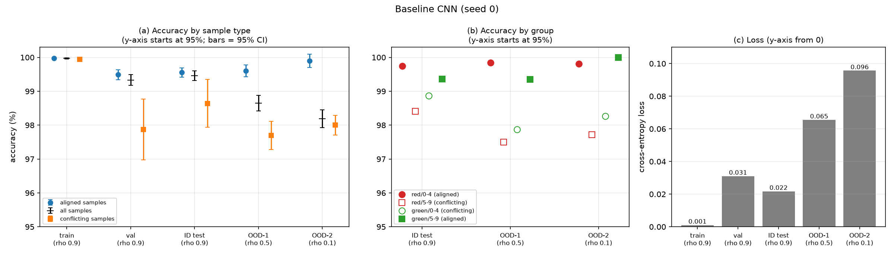
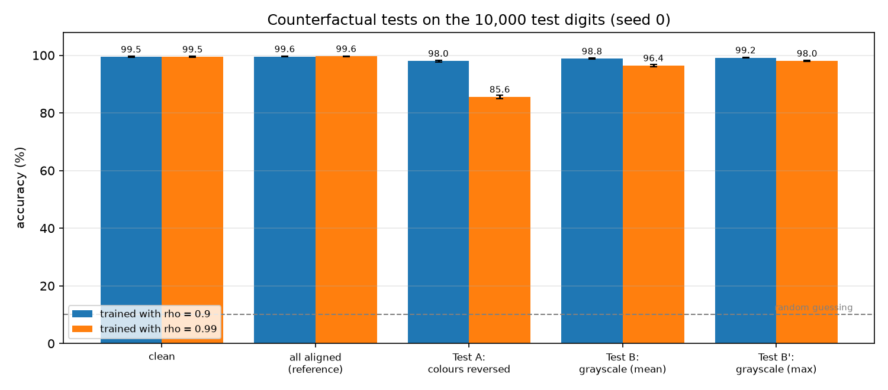

<h1 align="center">Colored MNIST:<br/> Detecting and Mitigating Spurious Correlations</h1>

<p align="center">
  Does a classifier decide by <b>shape</b> or by a <b>colour shortcut</b>, and what can we do about it?
</p>

<div align="center">
  
  
  <br>
  <em>Left: Colored MNIST (digits 0-4 mostly red, 5-9 mostly green). Right: baseline vs. three mitigation methods when colour is a strong shortcut (rho = 0.99).</em>
</div>

## Contents

[The problem](#the-problem) | [Our approach](#our-approach) | [Step by step](#step-by-step) | [Results at a glance](#results-at-a-glance) | [Conclusions](#conclusions) | [Deliverables](#deliverables) | [Reproduce](#reproduce) | [Structure](#project-structure) | [References](#references)

---

## The problem

A classifier can reach high accuracy for the **wrong reason**. If, in the training data, a feature that has nothing to do with the task (here: colour) happens to predict the label, the model may learn that *shortcut* instead of the real signal (the digit's shape). Test data that looks like the training data hides the problem; data where the shortcut stops working exposes it.

**Colored MNIST** makes this controllable. Every MNIST digit is painted red or green. With probability *rho* it gets its **natural colour** (digits 0-4 red, 5-9 green), otherwise the opposite one. *rho* is therefore the strength of the spurious correlation.

<div align="center">

| Set | Size | rho | Role |
|---|---|---|---|
| train | 50,000 | training rho | learning |
| validation | 10,000 | training rho | monitoring |
| ID test | 10,000 | training rho | same distribution as training |
| OOD-1 | 10,000 | 0.5 | colour carries no information |
| OOD-2 | 10,000 | 0.1 | correlation mostly reversed |

</div>

## Our approach

1. **Build** Colored MNIST ourselves and verify it.
2. **Train a baseline** CNN and measure how it degrades from ID to OOD data.
3. **Detect** which cue it uses: counterfactual colour edits, saliency, Grad-CAM, and shape-destroying misspecification tests.
4. **Mitigate** the shortcut with three methods (reweighting, Group DRO, LfF) and compare them with the baseline over three seeds.

We run everything in **two settings**: the handout's **rho = 0.9**, and a stronger-bias extension **rho = 0.99**. At rho = 0.9 the baseline barely suffers (little room for improvement), so rho = 0.99 is where the methods can be compared. OOD-1 and OOD-2 stay fixed, so the two settings are directly comparable.

## Step by step

Each step has a short report with the details, tables and figures.

### Step 1 - Dataset
Vectorised Colored MNIST construction with seeded, verifiable colouring (measured fractions match rho). [Report](reports/step1_report.md)

### Step 2 - Baseline training (Task 1)
SimpleCNN trained with Adam (lr 1e-3, batch 64, 20 epochs); it reaches 99.33% validation accuracy. [Report](reports/step2_report.md)

### Step 3 - ID / OOD evaluation, rho = 0.9 (Task 2)
Table 1: accuracy stays at 98.2-99.5% on all three test sets, so there is no collapse under shift, only a small colour effect on conflicting samples. [Report](reports/step3_report.md)

<div align="center">
  
</div>

### Step 4 - Stronger bias, rho = 0.99
Same pipeline with 99% aligned training samples: ID accuracy is unchanged (99.47%) but OOD-2 falls to 86.94%. [Report](reports/step4_report.md)

<div align="center">
  
</div>

### Step 5 - Counterfactual tests (Task 3.1)
Reversing or removing the colour of the same test digits measures colour reliance directly: a 1.6-point colour swing at rho = 0.9 versus 14.1 points at rho = 0.99. [Report](reports/step5_report.md)

<div align="center">
  
</div>

### Step 6 - Saliency, Grad-CAM and colour-flipped digits (Task 3.2-3.3)
Maps looked similar for both models, but counting the digits that flip when colour is reversed (14.2% vs 1.7%) shows that colour tips look-alike shapes such as 4/9 and 3/5. [Report](reports/step6_report.md)

<div align="center">
  
  <br>
  <em>First 10 colour-flipped digits (rho = 0.99): natural vs. reversed colour, Grad-CAM for the true and the wrong class.</em>
</div>

### Step 7 - Misspecification tests (Task 3.4)
Rotating or hiding part of the digit shows that the less shape information remains, the more the model leans on colour, and much more so at rho = 0.99. [Report](reports/step7_report.md)

<div align="center">
  
</div>

### Step 8 - Mitigation: reweighting and Group DRO (Task 4)
Both methods improve OOD accuracy in every seed (OOD-2 +10.3 and +6.9 points) using the colour label of the training samples. [Report](reports/step8_report.md)

### Step 9 - Mitigation: LfF and the final Table 3 (Task 4)
LfF recovers +6.1 OOD-2 points without any colour label, completing the three-method comparison. [Report](reports/step9_report.md)

## Results at a glance

**Baseline (Table 1, seed 0 for rho = 0.9; rho = 0.99 over 3 seeds)**

| Training rho | ID test | OOD-1 | OOD-2 | Gap ID-OOD2 |
|---|---|---|---|---|
| 0.9 | 99.46 | 98.65 | 98.19 | 1.3 |
| 0.99 | 99.42 +- 0.05 | 92.35 +- 0.70 | 86.93 +- 0.98 | 12.5 |

**Mitigation (Table 3, rho = 0.99, accuracy %, mean +- std over 3 seeds)** - full tables: [`reports/tables/table3_rho0.99.md`](reports/tables/table3_rho0.99.md)

| Method | ID | OOD-1 | OOD-2 | Gap ID-OOD2 | Worst group (OOD-1) | Colour labels |
|---|---|---|---|---|---|---|
| Baseline | 99.42 +- 0.05 | 92.35 +- 0.70 | 86.93 +- 0.98 | 12.48 | 82.66 +- 1.44 | - |
| Reweighting | 98.95 +- 0.31 | **97.96 +- 0.42** | **97.26 +- 0.61** | **1.69** | **96.16 +- 0.89** | yes |
| Group DRO | **99.44 +- 0.13** | 96.29 +- 0.39 | 93.80 +- 0.75 | 5.64 | 91.89 +- 0.49 | yes |
| LfF | 98.94 +- 0.13 | 95.63 +- 0.22 | 93.02 +- 0.38 | 5.92 | 90.46 +- 1.83 | no |

## Conclusions

- **The strength of the correlation decides how much the model leans on colour.** At rho = 0.9 the baseline loses only 1.3 points from ID to OOD-2; at rho = 0.99 it loses 12.5.
- **ID accuracy hides the shortcut.** The baseline scores about 99.4% ID in both settings; only OOD data and counterfactual edits reveal the difference. Validation data drawn like the training data cannot be used to detect it.
- **Colour is a fallback and tie-breaker, not the main cue.** Both models classify mostly by shape. Colour decides ambiguous look-alike digits (4/9, 3/5, 2/7) and gains influence as shape evidence is removed (colour pull on rotated digits: 63% at rho = 0.9, 87% at rho = 0.99).
- **Behavioural tests were more informative than attribution maps.** Saliency and Grad-CAM looked plausible for both models and could not separate them; counterfactual, flip-count and misspecification tests could.
- **All three mitigation methods help in every seed.** OOD-2 improves by +10.3 (reweighting), +6.9 (Group DRO) and +6.1 points (LfF), shrinking the ID-OOD2 gap from 12.5 to 1.7, 5.6 and 5.9 points.
- **More knowledge of the bias gives larger gains.** Reweighting (uses colour labels, strongest) > Group DRO ~ LfF (no labels). LfF and reweighting cost about 0.5 points of ID accuracy; Group DRO costs none.

**Limitations**

- Three seeds per configuration, and one seed for the rho = 0.9 analyses; repeated runs with the same seed also differ somewhat (GPU non-determinism), so differences of about one point (e.g. LfF vs. Group DRO) should not be ranked.
- No hyperparameter tuning; all methods use standard defaults and the final-epoch model (no selection on OOD data).
- The three test sets share the same digits; one dataset, one architecture, two colours.
- Reweighting and Group DRO use the colour label of every training sample; LfF's claim to up-weight conflicting samples is consistent with the results but its logged per-sample weights have not been analysed yet.
- Saliency and Grad-CAM are qualitative and coarse (Grad-CAM uses a 7x7 map).

## Deliverables

| Item | Where |
|---|---|
| Dataset construction and checks | [`spurious/data.py`](spurious/data.py), [`step1_check_data.py`](step1_check_data.py) |
| Baseline model and weights (Task 1) | [`task1_train_baseline.py`](task1_train_baseline.py), `outputs/models/baseline_model.pth` (rho = 0.9) and `baseline_model_rho0.99_seed{0,1,2}.pth` |
| Table 1: accuracy on train / val / ID / OOD-1 / OOD-2 (Task 2) | [`task2_evaluate.py`](task2_evaluate.py), `reports/tables/table1_*.md` |
| Table 2 and cue detection (Task 3.1-3.4) | `task3_*.py`, `plot_*.py`, `reports/tables/table2_*.md`, `misspec_*.md`, `flips_*.md`, `attribution_stats_*.md` |
| Mitigation methods and Table 3 (Task 4) | [`spurious/methods.py`](spurious/methods.py), [`task4_mitigation.py`](task4_mitigation.py), [`make_table3.py`](make_table3.py), [`reports/tables/table3_rho0.99.md`](reports/tables/table3_rho0.99.md) |
| Trained mitigation models and raw results | `outputs/models/`, `outputs/results/*.json` |
| Figures | `reports/figures/` |
| Step reports (write-up of every step) | [`reports/step1_report.md`](reports/step1_report.md) ... [`reports/step9_report.md`](reports/step9_report.md) |

This README is the project summary; each report holds the details of its step.

## Reproduce

```bash
pip install -r requirements.txt     # on Windows, install the CUDA build of PyTorch for GPU use

python -m step1_check_data                                   # step 1
python -m task1_train_baseline                               # step 2  (add --rho 0.99 --seed S for step 4)
python -m task2_evaluate                                     # step 3
python -m plot_table1
python -m task3_counterfactual  --rho 0.99                   # step 5  (steps 5-7: run the task3 scripts with and without --rho to cover both settings)
python -m plot_counterfactual
python -m task3_attribution     --rho 0.99                   # step 6
python -m task3_flips           --rho 0.99
python -m task3_misspecification --rho 0.99                  # step 7
python -m plot_misspecification
python -m task4_mitigation --rho 0.99 --methods reweighting group_dro lff --seeds 0 1 2   # steps 8-9
python -m make_table3
```

Baselines for seeds 1 and 2 (`task1_train_baseline` and `task2_evaluate` with `--rho 0.99 --seed S`) are needed before `make_table3`. Every script takes `--rho` and `--seed`; outputs for rho = 0.99 carry a `_rho0.99` tag, those for rho = 0.9 have none.

## Project structure

```
.
├── data/                      MNIST (downloaded automatically)
├── outputs/
│   ├── models/                trained weights (.pth)
│   └── results/               raw evaluation / history JSON files
├── reports/
│   ├── figures/               all figures used in the reports
│   ├── tables/                generated tables (.md)
│   └── step1_report.md ... step9_report.md
├── spurious/                  data, models, evaluation, cue detection, methods, plotting, utils
├── step1_check_data.py
├── task1_train_baseline.py    task2_evaluate.py
├── task3_counterfactual.py    task3_attribution.py    task3_flips.py    task3_misspecification.py
├── task4_mitigation.py        make_table3.py
├── plot_table1.py             plot_counterfactual.py  plot_misspecification.py
├── requirements.txt           LICENSE
└── README.md
```

## References

- M. Arjovsky, L. Bottou, I. Gulrajani, D. Lopez-Paz. *Invariant Risk Minimization*, 2019 (origin of Colored MNIST).
- S. Sagawa, P. W. Koh, T. B. Hashimoto, P. Liang. *Distributionally Robust Neural Networks for Group Shifts*, ICLR 2020 (Group DRO).
- J. Nam, H. Cha, S. Ahn, J. Lee, J. Shin. *Learning from Failure: Training Debiased Classifier from Biased Classifier*, NeurIPS 2020 (LfF).
- Z. Zhang, M. Sabuncu. *Generalized Cross Entropy Loss for Training Deep Neural Networks with Noisy Labels*, NeurIPS 2018 (GCE loss used by LfF).
- R. R. Selvaraju et al. *Grad-CAM: Visual Explanations from Deep Networks via Gradient-based Localization*, ICCV 2017.
- R. Geirhos et al. *Shortcut Learning in Deep Neural Networks*, Nature Machine Intelligence, 2020.
- Course handout and its listed references.

## License

See [`LICENSE`](LICENSE).