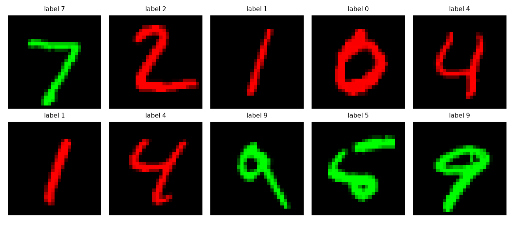

# Step 1 Report: Colored MNIST dataset

**Project:** Detecting and mitigating spurious correlations in image classification
**Course:** Trustworthy Machine Learning, practical project (weeks 1-2)
**Date:** 24 October 2026
**Files:** `spurious/data.py`, `step1_check_data.py`

## 1. Goal

Build the Colored MNIST dataset ourselves, as the handout requires, so that the strength of the
spurious colour-shape correlation can be controlled. The dataset provides five sets:

| Set | Size | rho | Role |
|---|---|---|---|
| `train` | 50,000 | 0.9 | training |
| `val` | 10,000 | 0.9 | validation |
| `test_id` | 10,000 | 0.9 | in-distribution test |
| `test_ood1` | 10,000 | 0.5 | OOD-1: colour independent of digit (unbiased) |
| `test_ood2` | 10,000 | 0.1 | OOD-2: correlation reversed |

Here *rho* is the probability that a sample receives its **natural colour**.

## 2. Implementation

**Conventions** (used throughout the project)

- Colour code `c`: `0` = red, `1` = green.
- Natural pairing: digits 0-4 are red, digits 5-9 are green.
- Each sample keeps its natural colour with probability `rho`; otherwise it gets the opposite colour.
- The colour of every sample is stored in `c`, so alignment and groups can be recovered later
  (reweighting, Group DRO, aligned vs. conflicting accuracy).

**`load_mnist`** reads `.data` / `.targets` from `torchvision.datasets.MNIST` as `uint8` tensors
of shape `(N, 28, 28)`. No `ToTensor()` and no per-sample loop are needed.

**`colorize(gray, y, rho, seed)`** is a vectorised version of the handout's `make_colored_mnist`:

1. `natural = (y >= 5)` gives the natural colour of every sample.
2. `keep = rand(N) < rho`, drawn from a seeded `torch.Generator`, decides which samples keep it.
3. `c = where(keep, natural, 1 - natural)` gives the final colour.
4. Images are stored as `uint8` `(N, 3, 28, 28)`. Each digit is pasted into exactly one channel
   (red or green) with boolean masks; the other two channels stay zero.

**`build_datasets`** splits the 60,000 MNIST training digits into 50,000 train and 10,000
validation digits with a seeded `randperm`, so the two sets contain different digits. Each set
uses a different colouring seed.

## 3. Deviation from the handout (to mention in the final report)

The handout's sample code slices the test set as `test_indices[10000:20000]` (OOD-1) and
`test_indices[20000:30000]` (OOD-2). MNIST has only **10,000** test digits, so both slices would
be empty.

**Our solution:** `test_id`, `test_ood1` and `test_ood2` all reuse the same 10,000 held-out test
digits, coloured with rho = 0.9 / 0.5 / 0.1 and different seeds. These digits never appear in
train or validation, so there is **no data leakage**. The only consequence is that the three test
sets share their digit shapes and differ only in colour assignment, which in fact makes
comparisons between them cleaner.

The dataset is fixed (`DATA_SEED = 42`). Later steps vary only the *model* seed.

## 4. Verification

All checks were run with `python -m step1_check_data` from the repository root.

| Check | Result |
|---|---|
| MNIST shapes / dtype | train `(60000, 28, 28)` and test `(10000, 28, 28)`, both `uint8` |
| Exactly one non-zero channel per image | passed |
| The non-zero channel equals `c` for every image | passed |
| Same seed gives identical colours | `True` |
| Different seed gives different colours | `True` |

**Fraction of samples with their natural colour**

| rho | Measured on the 10,000 test digits |
|---|---|
| 0.9 | 0.8995 |
| 0.5 | 0.4970 |
| 0.1 | 0.1035 |

**The five sets**

| Set | Size | Expected rho | Measured natural fraction |
|---|---|---|---|
| `train` | 50,000 | 0.9 | 0.8969 |
| `val` | 10,000 | 0.9 | 0.9011 |
| `test_id` | 10,000 | 0.9 | 0.8968 |
| `test_ood1` | 10,000 | 0.5 | 0.5017 |
| `test_ood2` | 10,000 | 0.1 | 0.1004 |

**Training digits per class (0-9):** 4923, 5613, 4958, 5093, 4863, 4546, 4933, 5204, 4882, 4985.

### Visual check



*Figure 1. The first 10 MNIST test digits coloured with rho = 0.9. Digits 0-4 appear red and
digits 5-9 appear green, as intended.*

## 5. Observations

- All measured fractions are within about 0.4 percentage points of the target rho, which is
  ordinary sampling noise.
- All ten digits in Figure 1 happen to carry their natural colour. This is expected: with rho = 0.9
  the chance that at least one of ten samples is conflicting is only about 65%. The measured
  fractions above are the reliable evidence that the flipping works.
- The classes are slightly imbalanced (5,613 ones versus 4,546 fives), inherited from MNIST. The
  majority-class rate is about 11%, not exactly 10%, which matters when judging near-chance
  accuracies on OOD-2 later.
- Of the 50,000 training images, about 5,000 are *conflicting* (colour opposite to the natural one).
  A model can therefore learn shape from them, so the baseline's OOD drop may be smaller than
  the handout predicts. We will report what is measured.

## 6. Reproduce

```bash
pip install -r requirements.txt
python -m step1_check_data      # prints the checks, writes reports/figures/check_samples.png
```

## 7. Next step

**Step 2 - baseline model and training:** `SimpleCNN` (split into `features()` / `head()` for
Grad-CAM later), an `evaluate` function, and the training script (Adam, lr 1e-3, batch 64,
20 epochs) with loss and accuracy curves and saved weights `baseline_model.pth`.