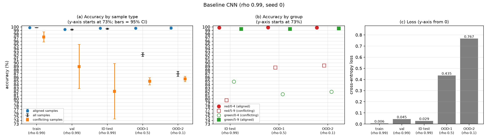
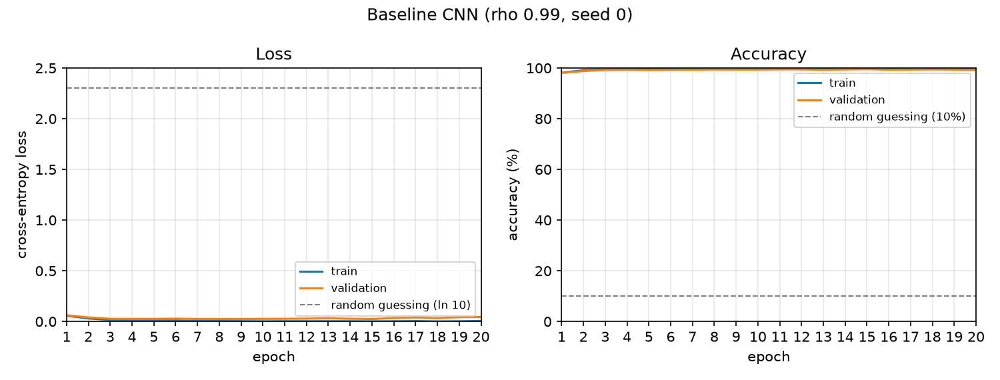

# Step 4 Report: Stronger-bias baseline (rho = 0.99)

**Date:** 24 October 2026

## Motivation

At rho = 0.9 the baseline lost only 1.3 points on OOD-2 (Step 3), leaving little room to compare
mitigation methods. We repeat Tasks 1-2 with rho = 0.99 for train, validation and ID test (about
538 of 50,000 training samples are conflicting, versus about 5,000 at rho = 0.9). OOD-1 (rho 0.5)
and OOD-2 (rho 0.1) are unchanged, so the two experiments are directly comparable. Same model,
hyperparameters and seed (0); final-epoch weights. The rho = 0.9 experiment remains the official
Task 1-2 result; this one is an extension.

## Results (rho = 0.99, seed 0)

| Set | rho | Accuracy (%) | Aligned (%) | Conflicting (%) | n conflicting | Loss |
|---|---|---|---|---|---|---|
| train | 0.99 | 99.80 | 99.82 | 97.21 | 538 | 0.0056 |
| val | 0.99 | 99.22 | 99.32 | 89.00 | 100 | 0.0446 |
| ID test | 0.99 | 99.47 | 99.64 | 82.11 | 95 | 0.0286 |
| OOD-1 | 0.5 | 92.30 | 99.66 | 84.89 | 4,983 | 0.4353 |
| OOD-2 | 0.1 | 86.94 | 99.70 | 85.52 | 8,996 | 0.7665 |

| Test set | red/0-4 (aligned) | red/5-9 (conflicting) | green/0-4 (conflicting) | green/5-9 (aligned) |
|---|---|---|---|---|
| ID test | 99.82 | 79.59 | 84.78 | 99.44 |
| OOD-1 | 99.88 | 88.72 | 81.33 | 99.43 |
| OOD-2 | 99.81 | 89.26 | 81.97 | 99.59 |

**Comparison with rho = 0.9** (same OOD sets)

| | rho = 0.9 | rho = 0.99 |
|---|---|---|
| ID test accuracy (%) | 99.46 | 99.47 |
| OOD-1 accuracy (%) | 98.65 | 92.30 |
| OOD-2 accuracy (%) | 98.19 | 86.94 |
| Drop ID to OOD-2 (points) | 1.27 | 12.53 |
| Conflicting accuracy on OOD-2 (%) | 98.00 | 85.52 |
| Loss on OOD-2 | 0.0957 | 0.7665 |

*Figure 1. (a) Accuracy for all / aligned / conflicting samples (95% CI), (b) accuracy per group,
(c) loss. Panels (a) and (b) use a truncated y-axis (starts at 73%).*

*Figure 2. Training curves. Validation accuracy reaches about 99.2-99.5% and stays flat.*

## Findings

1. **Clear colour reliance appears.** ID accuracy is unchanged (99.47% vs 99.46%), but accuracy
   falls to 92.30% on OOD-1 and 86.94% on OOD-2, drops of 7.2 and 12.5 points (0.8 and 1.3 at rho = 0.9).
2. **The failure is on conflicting samples.** Aligned accuracy stays at about 99.7% on every set,
   while conflicting accuracy is 82-86%. This is consistent with the totals
   (OOD-2: 0.1 x 99.70 + 0.9 x 85.52 = 86.94).
3. **Loss exposes it more strongly.** OOD-2 loss is 27x the ID loss (0.767 vs 0.029) and 8x the
   rho = 0.9 value, i.e. the model is often confidently wrong when colour contradicts shape.
4. **Partial, not total, reliance.** A purely colour-based classifier would score about 10% on
   conflicting samples; the model gets about 85%, so it still uses shape, but less reliably.
5. **Group asymmetry.** On OOD-1/OOD-2, red 5-9 digits (89%) are recognised better than green 0-4
   digits (81-82%), a gap of about 7 points that is large relative to its sampling error
   (thousands of samples per group). The cause has not been investigated.

## Interpretation

- **The number of conflicting training samples controls reliance.** Reducing them from about 5,000
  to 538 leaves the model too little signal to learn shape for colour-contradicting digits, so
  colour is used as a shortcut. This supports the handout's hypothesis, which rho = 0.9 did not.
- **ID and validation hide the problem.** Both are drawn with rho = 0.99, so their 99.2-99.5%
  accuracy says nothing about robustness (the validation set has only 100 conflicting samples).
  Model selection on validation would not detect the shortcut; OOD sets are needed.
- **Headroom for mitigation.** OOD-2 accuracy of 86.94% leaves up to about 12 points to recover,
  since aligned accuracy is already about 99.7%.

## Caveats

- One seed per rho. The ID conflicting subset has only 95 samples (CI of roughly +-8 points), so
  ID group numbers are noisy; conclusions rely on OOD-1 and OOD-2 (about 5,000 and 9,000
  conflicting samples).
- Only two values of rho were tried, so this shows a contrast, not a dose-response curve.
- The final epoch is reported (a small dip in train accuracy at epoch 20, from 99.93% to 99.80%,
  is within normal Adam noise).

## Next

Task 3 (cue detection: colour reversal, grayscale, saliency, Grad-CAM, misspecification) on both
baselines; then mitigation methods on rho = 0.99 with several seeds.