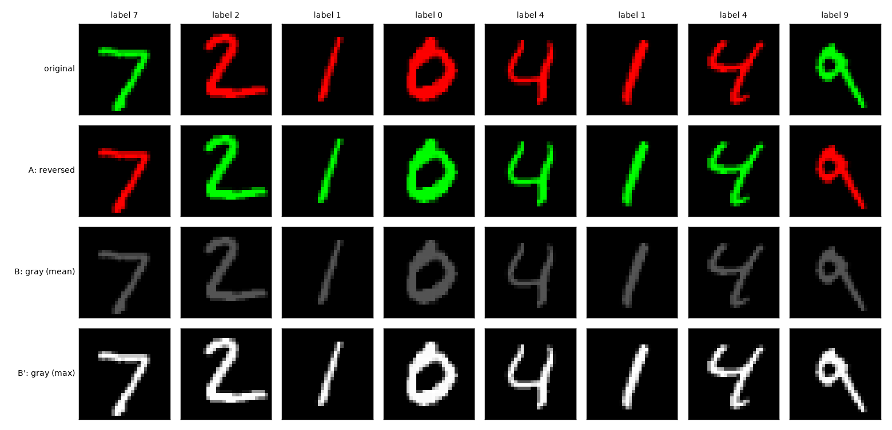

# Step 5 Report: Counterfactual tests (Task 3.1)

**Date:** 24 October 2026

## Method

Both baselines (rho = 0.9 and rho = 0.99, seed 0) are evaluated on the same 10,000 test digits
after editing only their colour:

- **Test A:** colours reversed (digits 0-4 green, 5-9 red), i.e. every sample conflicting.
- **Test B:** grayscale, all channels set to their mean (handout definition).
- **Test B' (control):** grayscale keeping full brightness (max over channels). Test B also divides
  the digit's brightness by 3; B' separates "colour removed" from "image dimmed".
- **Reference:** every digit in its natural colour (all aligned).

Colour swing = accuracy(all aligned) - accuracy(all reversed); it is 0 for a pure shape model.
Since every condition uses the same digits, differences are caused by the colour edit alone.

*Figure 1. Original digits and the three edits (A, B, B').*

## Results

| Condition | rho = 0.9 acc (%) | rho = 0.9 loss | rho = 0.99 acc (%) | rho = 0.99 loss |
|---|---|---|---|---|
| clean test set | 99.46 | 0.0217 | 99.47 | 0.0286 |
| all aligned (reference) | 99.58 | 0.0164 | 99.64 | 0.0176 |
| **Test A:** colours reversed | 98.02 | 0.1067 | **85.56** | 0.8448 |
| **Test B:** grayscale (mean) | 98.80 | 0.0395 | 96.41 | 0.1263 |
| **Test B':** grayscale (max) | 99.17 | 0.0712 | 98.05 | 0.1368 |
| Colour swing (pts) | 1.56 | | **14.08** | |

*Figure 2. Accuracy per condition; whiskers are 95% binomial CIs (n = 10,000).*

## Findings

1. **Colour reliance is small at rho = 0.9 and large at rho = 0.99.** Reversing the colours costs
   1.4 points at rho = 0.9 but 13.9 points at rho = 0.99; the colour swing is 1.6 vs 14.1 points.
2. **Consistent with Steps 3-4.** Test A (98.02% and 85.56%) reproduces the earlier accuracy on
   conflicting samples (98.00% and 85.52% on OOD-2), as expected for identical digits.
3. **Reversed colour is far more harmful than missing colour.** At rho = 0.99, removing colour with
   brightness kept (B') costs 1.4 points, while reversing it costs 13.9. Relative to B', correct
   colour adds +1.6 points and wrong colour subtracts 12.5. The model does not need colour, but is
   misled when it contradicts the shape.
4. **Part of Test B's drop is brightness, not colour.** B vs B' differ by 0.4 (rho = 0.9) and 1.6
   points (rho = 0.99), the effect of dimming alone.
5. **Loss tells the same story.** Test A multiplies the loss by 4.9 (rho = 0.9) and 29.5 (rho = 0.99)
   relative to clean data.

## Interpretation

- The stronger bias makes colour a **shortcut that overrides shape in about 14% of the cases where
  it conflicts**, while the model remains able to classify without colour (98.05% on B').
- This matches the training statistics: with only 538 conflicting training samples at rho = 0.99,
  there was too little pressure to make shape decisive against a contradicting colour.

## Caveats

- Single seed per rho; the rho comparison is one run each, though the gaps (about 12 points on Test A)
  are far larger than the sampling error (CI under 1 point).
- Grayscale images (three equal channels) are themselves unseen inputs, so even B' is not a perfectly
  clean "no colour" condition; its 1.4-point drop at rho = 0.99 may partly reflect this input shift.
- These tests measure behaviour, not mechanism; saliency and Grad-CAM (next) look at where the
  model is sensitive.
