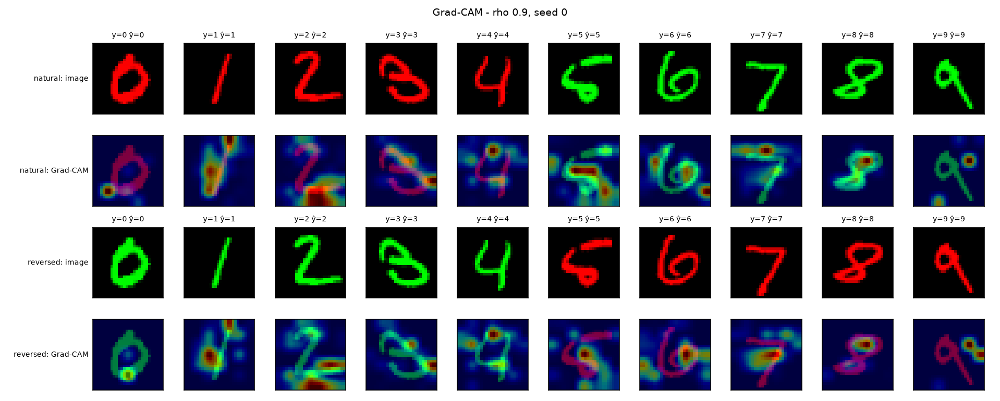
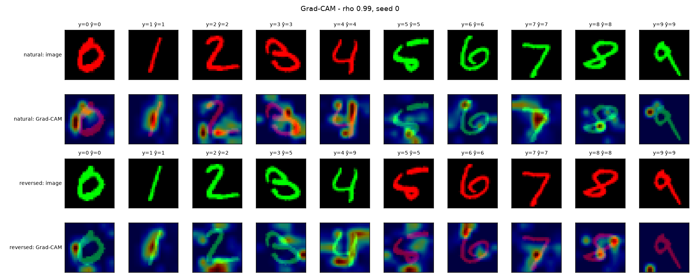
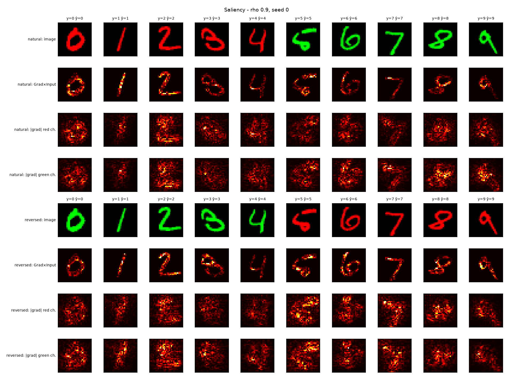
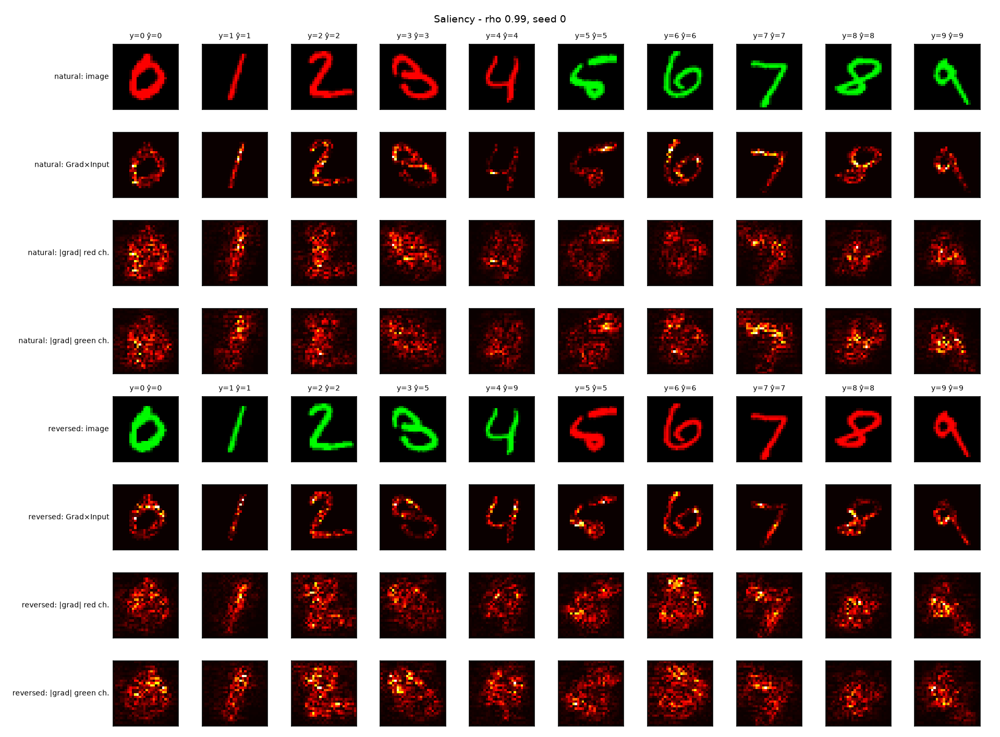
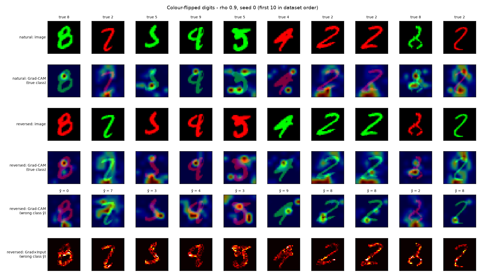
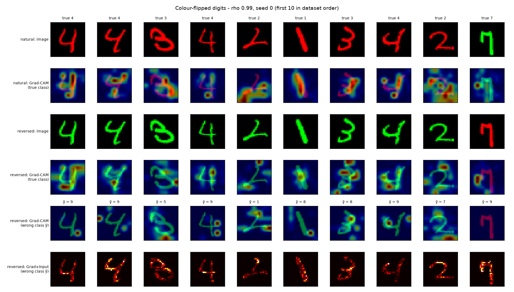

# Step 6 Report: Saliency, Grad-CAM and colour-flipped digits (Task 3.2-3.3)

**Date:** 25 October 2026

## Method

For both baselines (rho = 0.9 and rho = 0.99, seed 0) we explain the true-class score of 100 test
digits (10 per class), once in the natural colour and once with the colour reversed (identical
shapes, so differences come from colour alone).

- **Gradient x Input** (|grad x input|, max over channels) and the **plain gradient per colour
  channel**. Since the empty channel and the background are 0, Gradient x Input is zero off the
  digit by construction.
- **Grad-CAM** on the last conv layer (7x7, upsampled to 28x28).
- **Statistics:** share of map mass lying on digit pixels (digits cover 0.168 of the image, the value
  for a uniform map) and share of gradient in the digit's own colour channel.
- **Variant (flipped digits):** over all 10,000 test digits we find those classified correctly in
  natural colour but wrongly in reversed colour, and analyse them. Control for the boundary statistic:
  errors of the same model on colour-free grayscale images (Test B').

## Results

### Maps on 100 digits

| | Colour | Accuracy (%) | Grad-CAM mass on digit | Gradient mass on digit | Gradient share in own channel |
|---|---|---|---|---|---|
| rho = 0.9 | natural | 99.0 | 0.251 | 0.355 | 0.542 |
| rho = 0.9 | reversed | 100.0 | 0.233 | 0.350 | 0.531 |
| rho = 0.99 | natural | 100.0 | 0.291 | 0.384 | 0.542 |
| rho = 0.99 | reversed | 88.0 | 0.237 | 0.366 | 0.527 |

*Figure 1. Grad-CAM (one digit per class; titles show true label y and prediction y-hat). At
rho = 0.99, a green 3 is predicted as 5 and a green 4 as 9; at rho = 0.9 all ten stay correct.*

*Figure 2. Gradient x Input and per-channel plain gradient, natural and reversed colour.*

### Colour-flipped digits (all 10,000 test digits)

| | rho = 0.9 | rho = 0.99 |
|---|---|---|
| Flipped digits | 164 of 9,958 (1.65%) | 1,416 of 9,964 (14.21%) |
| 0-4 painted green: flip rate | 1.46% (75 / 5,126) | 17.86% (916 / 5,130) |
| 5-9 painted red: flip rate | 1.84% (89 / 4,832) | 10.34% (500 / 4,834) |
| Wrong answer crosses the 0-4 / 5-9 boundary | 92.1% | 97.7% |
| Control: errors on grayscale images crossing the boundary | 71.1% (n = 83) | 70.8% (n = 195) |
| Most frequent confusions | 9>4, 4>9, 5>3, 2>8, 7>1 | 4>9 (264), 2>7, 3>8, 3>5, 2>8 |

| Map statistics on flipped digits | Grad-CAM mass on digit | Gradient mass on digit | Gradient share in own channel |
|---|---|---|---|
| rho = 0.9 (164 digits): natural, true class | 0.262 | 0.359 | 0.541 |
| rho = 0.9: reversed, true class | 0.270 | 0.358 | 0.532 |
| rho = 0.9: reversed, wrong class | 0.286 | 0.361 | 0.539 |
| rho = 0.99 (1,000 digits): natural, true class | 0.325 | 0.386 | 0.537 |
| rho = 0.99: reversed, true class | 0.251 | 0.369 | 0.540 |
| rho = 0.99: reversed, wrong class | 0.272 | 0.382 | 0.548 |

*Figure 3. First 10 flipped digits in dataset order: natural vs reversed colour, Grad-CAM for the
true class and for the wrong class, and Gradient x Input for the wrong class.*

## Findings

1. **Flip counts reproduce the earlier colour effect.** The rho = 0.99 model flips 8.6x more often
   (14.2% vs 1.7%), matching the colour swings of Step 5 (14.1 and 1.6 points).
2. **Flips follow the colour, in both models.** 97.7% and 92.1% of wrong answers cross the 0-4 / 5-9
   boundary, versus about 71% for the same models' errors on colour-free images (95% CIs for the
   control roughly 64-77% and 61-81%, clearly below the flip values). Ordinary look-alike
   confusions (4/9, 3/5) already straddle the boundary, which is why this control matters.
3. **Colour tips look-alike shapes.** The leading flips are 4>9, 2>7, 3>8, 3>5, 2>8; no clear shape is
   turned into an unrelated digit.
4. **Direction asymmetry at rho = 0.99.** Green 0-4 digits flip 1.7x as often as red 5-9 digits
   (17.9% vs 10.3%), in line with the group asymmetry of Step 4. At rho = 0.9 the two rates are
   similar (1.5% vs 1.8%, within noise). The cause was not investigated.
5. **Saliency does not separate the two models.** Gradient x Input highlights strokes in all conditions,
   and the plain-gradient statistics are the same for both models (gradient on digit 0.35-0.39,
   own-channel share 0.53-0.55) although their behaviour differs strongly.
6. **Grad-CAM gives only a weak signal.** Mass on the digit falls under reversal at rho = 0.99
   (0.291 to 0.237 on 100 digits; 0.325 to 0.251 on flipped digits) but not at rho = 0.9
   (0.251 to 0.233; 0.262 to 0.270).

## Interpretation

Colour acts as a tie-breaker between look-alike shapes: when shape evidence is ambiguous, a colour
typical of the other digit group tips the decision. The evidence for this is behavioural (flip
counts, direction of the errors, control). The maps look plausible for both models and do not reveal
how different their reliance on colour is, which illustrates that attribution maps can miss a
spurious cue and should be backed by counterfactual tests.

## Caveats

- One seed per rho; map statistics come from 100 (or 164 / 1,000 flipped) digits without error bars.
- Flipped digits are selected by a prediction change, so lower stroke focus under reversal (finding 6)
  is partly built into the selection; absolute values are not comparable across models.
- Grad-CAM (7x7) is coarse; Gradient x Input cannot show colour sensitivity by construction.
- The control uses grayscale images, themselves unseen inputs; the rho = 0.9 control rests on only 83 errors.
- Maps explain the true class (and, in the variant, the wrong class); they were not tuned or
  selected, and the 10 digits shown are the first in dataset order.
