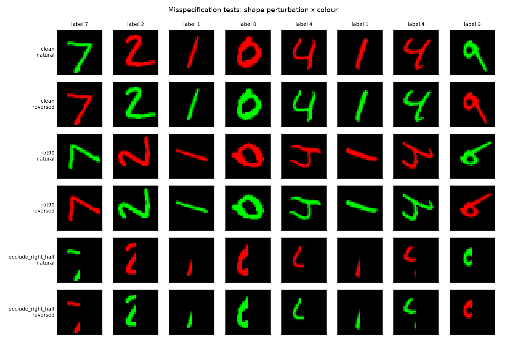
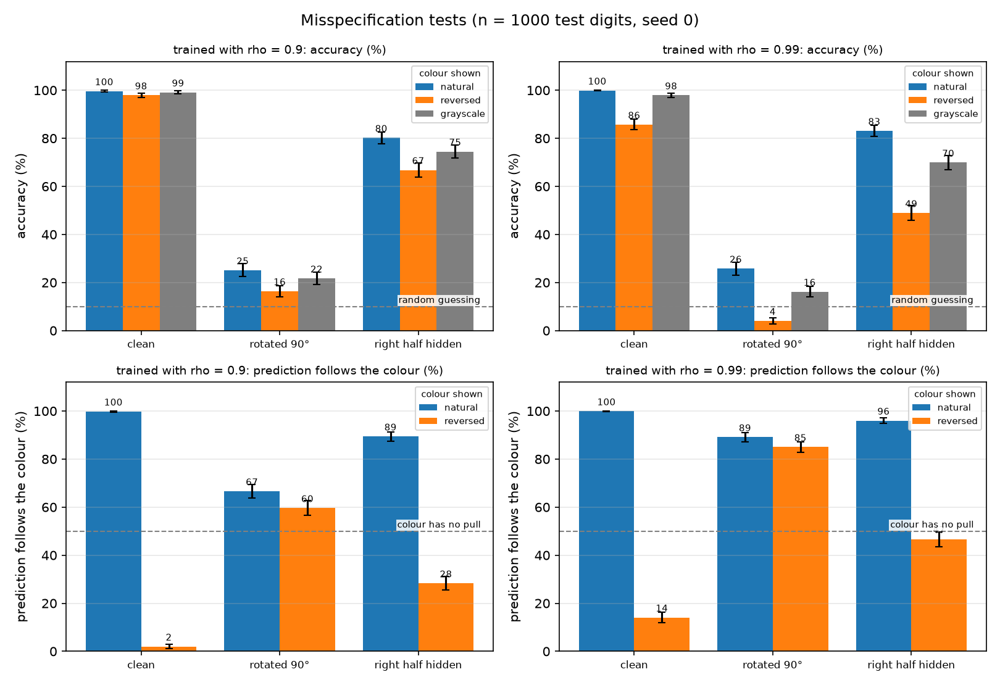

# Step 7 Report: Misspecification tests (Task 3.4)

**Date:** 25 October 2026

## Method

Both baselines (rho = 0.9 and rho = 0.99, seed 0) are evaluated on 1,000 random test digits under
every combination of a **shape change** and a **colour condition** (95% CI at most +-3.1 points):

- Shape: clean, rotated by 90 degrees, right half of the image hidden.
- Colour: natural (0-4 red, 5-9 green), reversed, grayscale (colour removed, full brightness).

Colour is always re-painted after the shape change, so differences between colour conditions on the
same shape are caused by colour alone. Besides accuracy we measure how often the **predicted group
(0-4 or 5-9) matches the group the shown colour points to** (green = 5-9, red = 0-4). A model that
ignores colour makes the same prediction under both colourings, so the "natural" and "reversed"
values sum to 100%. Their mean is therefore the **colour pull**: 50% = none, 100% = always obeys colour.

*Figure 1. First 8 test digits under each condition (shape perturbation x colour).*

## Results

**Accuracy (%)**

| Shape | rho = 0.9: natural | reversed | grayscale | rho = 0.99: natural | reversed | grayscale |
|---|---|---|---|---|---|---|
| clean | 99.6 | 97.9 | 99.1 | 99.9 | 85.7 | 97.9 |
| rotated 90 deg | 25.1 | 16.4 | 21.7 | 25.8 | 4.0 | 16.2 |
| right half hidden | 80.2 | 66.8 | 74.5 | 83.1 | 48.9 | 69.9 |

**Prediction follows the colour (%)**

| Shape | rho = 0.9: natural | reversed | **colour pull (mean)** | rho = 0.99: natural | reversed | **colour pull (mean)** |
|---|---|---|---|---|---|---|
| clean | 99.8 | 2.0 | **50.9** | 99.9 | 14.1 | **57.0** |
| rotated 90 deg | 66.6 | 59.6 | **63.1** | 89.1 | 85.0 | **87.1** |
| right half hidden | 89.4 | 28.3 | **58.9** | 96.0 | 46.7 | **71.4** |

*Figure 2. Top: accuracy per condition. Bottom: how often the predicted group follows the shown
colour; the black diamond is the colour pull (mean of the two bars, 50 = no pull).*

## Findings

1. **Sanity check.** The clean row reproduces Step 5 (reversed colour 97.9% and 85.7%; grayscale
   99.1% and 97.9%).
2. **The model needs shape.** Rotating the digit drops accuracy to 4-26% and hiding half of it to
   49-83%.
3. **Colour matters more as shape evidence weakens, in both models.** The accuracy gap between natural
   and reversed colour grows from 1.7 to 8.7 to 13.4 points at rho = 0.9, and from 14.2 to 21.8 to
   34.2 points at rho = 0.99 (clean, rotated, half hidden). Even the rho = 0.9 model, almost
   colour-independent on clean digits (colour pull 50.9%), is clearly pulled by colour on altered shapes (59-63%).
4. **The rho = 0.99 model is much more colour-driven.** On rotated digits its predicted group follows
   the shown colour 87% of the time versus 63% for rho = 0.9. With reversed colour its accuracy falls to
   4.0%, below the 10% chance level: its answers are pushed systematically into the wrong group.
5. **Correct colour helps and wrong colour hurts, around the colour-free baseline.** On half-hidden
   digits (grayscale in the middle): rho = 0.9 gives 80.2 / 74.5 / 66.8 and rho = 0.99 gives
   83.1 / 69.9 / 48.9 for natural / grayscale / reversed.
6. **Identical shape recognition, different colour dependence.** Under natural colour both models have
   about the same accuracy on rotated digits (25.1% and 25.8%); they differ in how they react once the colour
   is withdrawn or reversed.

## Interpretation

Colour acts as a fallback cue: when the shape is clear it hardly matters, and the less informative
the shape, the more the model leans on colour. The strength of that fallback is set by the training
correlation (rho = 0.99 learns a much heavier dependence than rho = 0.9). This fits the tie-breaker
picture from the flipped-digit analysis (Step 6), and shows that the rho = 0.9 model is not colour-free,
only far less colour-dependent.

## Caveats

- Rotated and half-hidden digits are unseen inputs, so low accuracy is expected on its own; the
  conclusions rest on comparing colour conditions for the same perturbed images.
- Hiding the right half removes much of the digit (see Figure 1), so it is a severe, not subtle, change.
- n = 1,000 per cell and a single seed; differences of a few points (e.g. 63 vs 59) are not reliable.
- Grayscale images are themselves unseen inputs.

## Next

Task 4: bias mitigation methods on rho = 0.99 (at least two of reweighting, Group DRO, LfF, IRM,
augmentation) with several seeds, compared in Table 3.