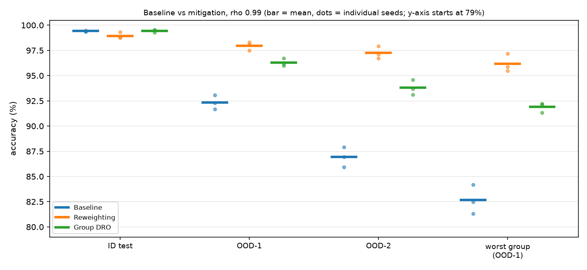

# Step 8 Report: Bias mitigation, part 1 (Task 4)

**Date:** 25 October 2026

## Method

All experiments use rho = 0.99 (train, validation, ID test); OOD-1 (rho 0.5) and OOD-2 (rho 0.1)
are unchanged. Every method uses the baseline's setup (SimpleCNN, Adam, lr 1e-3, batch 64, 20 epochs,
final-epoch weights, no model selection on OOD data) and only changes the training loss. Three seeds
(0, 1, 2) per method; the baseline was retrained for seeds 1 and 2 so that seeds can be paired.

- **Sample reweighting:** loss weight w = 1 / P(colour | digit), estimated on the training set and
  rescaled to mean 1. Aligned samples get weight about 0.5, conflicting ones about 46.5.
- **Group DRO** (Sagawa et al.): four groups (colour x digit 0-4 / 5-9); per-group weights q are
  increased multiplicatively (step 0.01) for groups with high loss and the model minimises the
  q-weighted group loss, so it is pushed toward its worst group.
- **Worst group** = lowest accuracy among the four groups on OOD-1, where all groups are of similar size.
- No hyperparameters were tuned. Both methods use the colour label of every training sample.

## Results

**Table 3. Accuracy (%), mean +- standard deviation over 3 seeds**

| Method | ID | OOD-1 | OOD-2 | Gap ID-OOD1 | Gap ID-OOD2 | Worst group (OOD-1) |
|---|---|---|---|---|---|---|
| Baseline | 99.42 +- 0.05 | 92.35 +- 0.70 | 86.93 +- 0.98 | 7.07 +- 0.72 | 12.48 +- 1.00 | 82.66 +- 1.44 |
| Reweighting | 98.95 +- 0.31 | **97.96 +- 0.42** | **97.26 +- 0.61** | **0.99 +- 0.46** | **1.69 +- 0.73** | **96.16 +- 0.89** |
| Group DRO | **99.44 +- 0.13** | 96.29 +- 0.39 | 93.80 +- 0.75 | 3.15 +- 0.35 | 5.64 +- 0.67 | 91.89 +- 0.49 |

**Individual runs (OOD-2 accuracy, %)**

| Method | Seed 0 | Seed 1 | Seed 2 |
|---|---|---|---|
| Baseline | 86.94 | 85.95 | 87.91 |
| Reweighting | 97.93 | 97.12 | 96.73 |
| Group DRO | 93.11 | 93.70 | 94.59 |

**Change versus the baseline with the same seed (points)**

| Method | ID | OOD-1 | OOD-2 |
|---|---|---|---|
| Reweighting | -0.47 (-0.69, -0.11, -0.61) | +5.61 (+6.02, +6.38, +4.43) | **+10.33** (+10.99, +11.17, +8.82) |
| Group DRO | +0.02 (-0.18, +0.14, +0.11) | +3.94 (+3.67, +4.49, +3.66) | **+6.87** (+6.17, +7.75, +6.68) |

*Figure 1. Accuracy per method; bars are means, dots individual seeds (y-axis starts at 79%).*

## Findings

1. **Both methods help in every seed.** OOD-2 improves by 10.3 points (reweighting) and 6.9 points
   (Group DRO); the per-seed gains (8.8-11.2 and 6.2-7.8) are far larger than the seed-to-seed
   spread (std 0.6-1.0), and the seed ranges of the three methods on OOD-2 do not overlap.
2. **Reweighting is stronger on OOD data.** It reaches 97.3% on OOD-2 against 93.8% for Group DRO, and
   96.2% against 91.9% worst-group accuracy.
3. **Reweighting pays a small ID cost; Group DRO does not.** ID accuracy falls by 0.5 points on average
   under reweighting (0.1-0.7 depending on seed) and is unchanged under Group DRO.
4. **The gaps shrink strongly.** ID-OOD2 gap: 12.5 points (baseline), 5.6 (Group DRO), 1.7 (reweighting).
   Neither method fully closes it.
5. **The worst group gains most.** Worst-group accuracy rises from 82.7% to 91.9% and 96.2%.

## Interpretation

Both methods raise the influence of the few conflicting training samples (about 540 of 50,000), which
is what the baseline lacked (Steps 4-7): reweighting does it per sample and very strongly, Group DRO
adaptively through group weights. The stronger intervention gives larger OOD gains at a small ID cost,
a robustness-accuracy trade-off.

## Caveats

- Three seeds only. Re-running seed 0 of the same method gave visibly different results (for example
  OOD-2 for Group DRO ranged from 93.1% to 95.5% across repeated runs, for reweighting from 97.1% to
  97.9%), so GPU training is not exactly reproducible and run-to-run noise may exceed the
  3-seed standard deviation.
- Hyperparameters were not tuned; the ranking of Group DRO (step size 0.01) against reweighting may
  change with tuning.
- Both methods need the colour label of every training sample; in practice the bias attribute is
  often unknown (LfF and similar methods avoid this).
- Results are for one dataset, one architecture and rho = 0.99 only.
